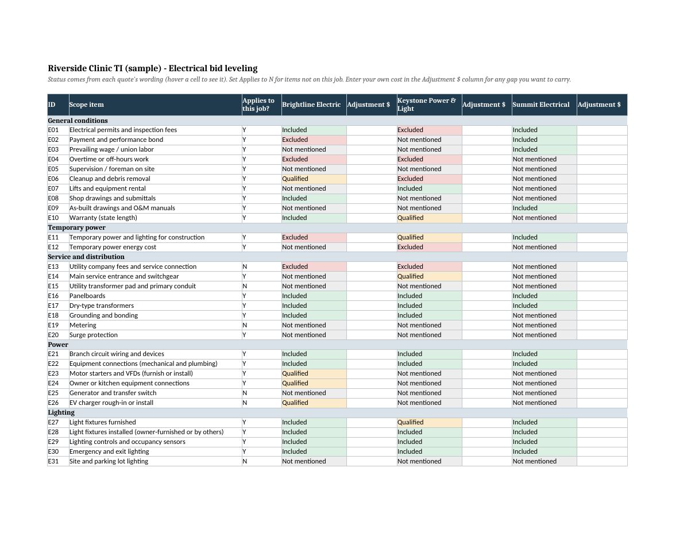

# Bid Day Kit: free bid leveling for electrical

Drop in two or more electrical subcontractor quotes. Get back an Excel leveling sheet that shows, for 53 scope items, which bidder included it, excluded it, qualified it, or never mentioned it. Every answer links back to the quote's own words.

It runs as a skill inside Claude. It reads the quotes; you make the call.

## What you get

- **Summary tab:** base price, your adjustments, adjusted total, and counts of excluded, not-mentioned and qualified items per bidder.
- **Leveling tab:** scope items as rows, bidders as columns, color-coded. Hover a cell to see the quote line behind it. Mark items that don't apply to the job, and type your own cost for any gap so totals compare fairly.
- **Questions tab:** a ready-to-send list of clarification questions for each bidder.
- **Alternates & allowances tab:** every alternate and allowance pulled from the quotes.

## Install (about 2 minutes)

1. Download `bid-leveling.zip` from this repo.
2. In the Claude app, open Settings, find **Skills**, and upload the zip. Code execution needs to be turned on.
3. Start a chat, attach your quotes, and say "level these electrical bids".

## Try it on the samples

The `samples` folder has three quotes from made-up companies for a made-up project, plus the sheet the skill produced from them. Their formats, typos and exclusion lists are modeled on real subcontractor quotes posted in public agency meeting packets, so they're about as messy as the real thing. Attach the three PDFs in Claude and compare your result.

## What it doesn't do

- It doesn't pick a winner or estimate the cost of a gap. That's your judgment.
- It only covers electrical. The full kit adds 20+ trades, clarification emails, a bid-day summary, and question and change-order logs. **[Join the waitlist](https://mboettner10.github.io/bid-day-kit/#waitlist)** for early access and an early-bird price.

## Privacy

Your quotes stay in your own Claude chat. Nothing is sent anywhere else.

## License

MIT. Use it on as many bids as you like.
